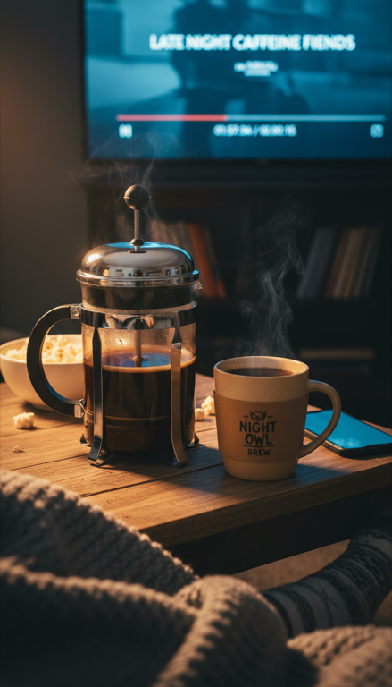

# creative harness

An agent loop that turns a creative brief into finished content, and shows its working. It explores many ideas, picks between them with a bias-checked tournament, critiques its own renders against a written rubric, revises, and only then spends on a high-quality final.

Built in Bun and TypeScript on [fal](https://fal.ai), for **No Slop Allowed** (36 Labs x fal, London, 28 Nov 2026).



**First live run** (coffee brief, defaults): 8 concepts, 12 pairwise matches (each judged twice), 3 finalists developed in parallel, one hero render. **3.5 minutes, about $0.30, 50 model calls, no errors.** The image on the right is the winner.

That run also showed the improve loop wasn't improving: draft scores went 4→5→4, 4→3 and 3→4→2. See [What the first live run taught it](#what-the-first-live-run-taught-it).

<br clear="right">

## How it works

```
brief
  │
  ▼
1. diverge     director LLM writes N concepts, each forced onto a different axis
  │            (emotional register, format, hook mechanism, point of view...)
  ▼
2. select      Swiss tournament of pairwise judgements on the text alone.
  │            Every match is judged twice with A and B swapped, to catch position bias.
  ▼
3. develop     for each of K finalists, in parallel:
  │              cheap draft render → vision critic scores it against rubric.md → reviser
  │              repeats until the critic says ship, the score stops rising, or rounds run out
  ▼
4. showdown    vision judge compares the finalists' best renders head to head
  │
  ▼
5. final       hero render on a stronger model (+ optional 5s image-to-video)
```

Every decision emits a trace event. The UI polls the run and shows rejected concepts, every match and its reason, each draft with its score, flagged slop and the fixes applied, and a running cost counter.

## Design decisions

**Choose with pairwise comparisons, not scores.** LLMs are poor at absolute scores ("7/10") and much better at "which of these two is better, and why". Selection is a tournament of comparisons:
- **Swiss rounds** for large fields, so 8 concepts need 12 matches rather than 28.
- **Round-robin** for 3 or fewer, so the final pick is always settled by a direct match.
- **Byes** go to the lowest-ranked contender that hasn't had one, so nobody goes unjudged.
- **Ties** break on head-to-head, then on the judge's confidence.

**Check the judge for position bias.** Each match runs twice with the order swapped. If the two verdicts disagree, the match is marked order-biased in the UI and decided by confidence. Running both orders in parallel with `Promise.allSettled` means one failed call doesn't lose the match.

**Critique what was rendered, not what was asked for.** A vision model looks at the actual image and scores it against [rubric.md](rubric.md), a plain-language list of what makes content stop a scroll and what counts as slop. The rubric is re-read on every call, so taste can be tuned while the server runs.

**Enforce the rubric's hard rules in code.** The rubric says any slop flag caps the score at 5. Models don't apply that reliably, so `normaliseCritique` does: it caps the score, downgrades "ship" to "revise", and drops empty or "none" entries that models echo back from the JSON template.

**Treat model output as untrusted input.** Every LLM response is pulled out of whatever prose surrounds it and validated with a zod schema. On a validation failure it retries once, sending the error back to the model.

**Spend cheaply until the decision is made.** Concepts are compared as text. Drafts use FLUX schnell (about $0.002, 1s). Only the winner gets the expensive model.

**Fail loudly before spending, carry on after.** A failure before money is spent stops the run. After that, one failed call is logged and the run continues:
- A failed revision keeps the last critiqued version.
- A failed showdown falls back to critic scores.
- A failed hero critique keeps the image.

**Respect the provider's limits.** Every fal call goes through one shared concurrency limiter (new fal accounts start at 2 parallel requests), with per-kind timeouts. `bun run smoke --parallel N` measures the real cap.

**Never guess an API.** Model ids and input/output shapes live only in [src/models.ts](src/models.ts). Each was checked against fal's published schema first. Models disagree in small ways: `768P` vs `720p`, `image_url` vs `start_image_url`, `image_size` vs `aspect_ratio`. `bun run smoke` checks every model against the live API for a few cents.

**Run offline by default.** With no key, a deterministic mock LLM and SVG placeholders run the whole loop and UI for free. `MOCK_FAIL=<regex>` makes chosen calls fail, to rehearse failure paths. Tests always run in mock mode, enforced by a preload, so they can never spend money.

## What the first live run taught it

The first live run's trace showed why the improve loop didn't improve:

1. **The reviser added things.** To fix "concept and image disagree" it added title cards, numbered labels and four-panel montages. The draft model can't draw text or panels, so each version picked up new problems.
2. **The score cap fired on every draft.** Cheap drafts nearly always trip some slop flag, so no draft could pass 5 and none could reach the 8.5 needed to ship.
3. **Some concepts were video ideas drawn as stills**, such as quick-cut montages with video switched off.
4. **The loop stopped after one worse version**, so it never got a second try.

<!-- RESULTS-V2 -->

## Run it

Needs [Bun](https://bun.sh) 1.3+.

```bash
bun install
```

```bash
bun run dev
```

Open http://localhost:3000, pick a brief and press Run. With no key it runs in mock mode, offline and free.

### Live, with fal

```bash
cp .env.example .env
```

Add your `FAL_KEY` to `.env`, then check every model works with your account:

```bash
bun run smoke
```

Optionally measure how many calls fal lets you run at once, and set `CONCURRENCY` to match:

```bash
bun run smoke --parallel 6
```

| Command | What it does |
|---|---|
| `bun run start` | Server without file watching (use this for live demos) |
| `bun run harness briefs/example-coffee.md` | Run from the terminal. Flags: `--video`, `--concepts N`, `--finalists K`, `--iters N` |
| `bun run check` | Typecheck and tests (always mock, never spends) |
| `bun run smoke --video` / `--all` | Also test the video model / every model |

LLM calls go through fal's OpenRouter router, so one `FAL_KEY` covers image, video and text. Set `LLM_MODEL` or `VISION_MODEL` in `.env` to swap models.

## Layout

| Path | Role |
|---|---|
| `src/harness/director.ts` | Writes diverse concepts |
| `src/harness/selector.ts` | Pairwise judge, Swiss and round-robin tournaments |
| `src/harness/critic.ts` | Vision critic, rubric enforcement, reviser |
| `src/harness/loop.ts` | Orchestration, failure handling |
| `src/models.ts` | Every fal model: input builder, output picker, cost estimate. `ROLES` maps jobs to models |
| `src/prompts.ts`, `rubric.md` | All prompt wording and the judging criteria, kept out of the loop code |
| `src/llm.ts`, `src/fal.ts` | LLM calls with JSON validation and retry; the rate-limited fal client |
| `src/trace.ts` | Run state and events, saved to `runs/<id>.json` |
| `src/server.ts`, `public/index.html` | API and single-page live UI |
| `src/mock.ts` | Offline mock LLM with failure injection |
| `test/` | Tournament fairness, rubric enforcement, end-to-end and failure-path tests |

## Cost and speed

Measured on the first live run with defaults (8 concepts, 3 finalists, up to 3 revisions each): **213 seconds, about $0.30, 50 calls**. Most of the time goes on LLM calls at concurrency 2. Video adds about $0.20 for 5 seconds. The spend counter uses fal's reported LLM cost plus per-model estimates, so treat it as a guide.

## Ideas not built yet

- **Revise with image edits, not re-rolls**: pass the previous image and fixes to an edit model so v2 keeps what worked.
- **Attention predictor**: a separate judge that only scores "would I stop scrolling in the first second".
- **Storyboarded video**: Kling v4 takes start, end and middle keyframes.
- **Sound**: voiceover, music, or audio added to a silent clip.
- **Learn across runs**: keep the critic fixes that raised scores and feed them to the director next time.

## Licence

[MIT](LICENSE)
